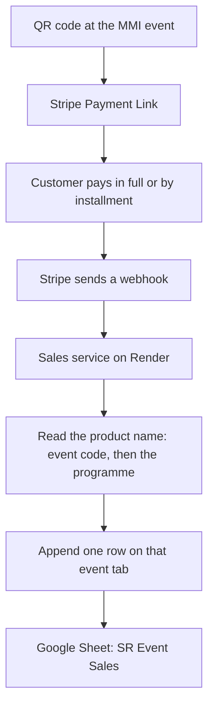

# Event sales: Stripe payments into one Google Sheet

On-site MMI sales. A participant scans a QR code, pays in Stripe (full payment or an installment), and that payment is written into one central Google Sheet. This project is separate from the Zendesk agents. Maya, Quinn, and Rafa do not read or write these payments.

## Overview



A product named `MMI2610ROT | Quantum Leap 2027` is a sale at Rotterdam MMI in October 2026. The row goes on the tab `MMI2610ROT`. The programme column says `Quantum Leap 2027`.

## What gets captured

Each successful Stripe payment for a programme sold at an MMI event. The programmes are:

- Quantum Leap 2027
- Enlightened Warrior Camp 2027
- Train the Trainer 2027
- Guerrilla Business Intensive 2027
- Never Work Again 2027
- Speed Wealth Book

The year on Quantum Leap, Enlightened Warrior Camp, Train the Trainer, Guerrilla Business Intensive, and Never Work Again is the year of that programme (2027 in this set). Speed Wealth Book has no year in the name. The MMI event where the QR code is scanned is a different date, and that date is the left side of the Stripe name.

## How Stripe products are named

The product name is the MMI event, a space, a vertical bar, a space, then the programme.

`MMI` + two-digit year + two-digit month + the city's first three letters + ` | ` + programme name.

Madrid, September 2026, is `MMI2609MAD`. The six products for that room are:

- `MMI2609MAD | Quantum Leap 2027`
- `MMI2609MAD | Enlightened Warrior Camp 2027`
- `MMI2609MAD | Train the Trainer 2027`
- `MMI2609MAD | Guerrilla Business Intensive 2027`
- `MMI2609MAD | Never Work Again 2027`
- `MMI2609MAD | Speed Wealth Book`

Another city uses its own three letters. Stockholm in September 2026 would be `MMI2609STO | Quantum Leap 2027`, and the same five other names after the bar. Madrid in October 2026 would be `MMI2610MAD | Quantum Leap 2027`.

The service reads the Stripe product name. It does not expect names like `NWA-MMI2609STO`.

- Text before the bar, with spaces removed and letters uppercased, is the event code and the sheet tab. `MMI 2609 Mad` and `MMI2609MAD` both become `MMI2609MAD`.
- Text after the bar is the programme, stored as written: `Quantum Leap 2027`, `Speed Wealth Book`, and so on.
- A name with no bar, or an event code that is not `MMI` plus four digits plus three letters, is not written to the sheet. It is logged so it can be matched by hand.

Each product has two prices when both ways of paying exist:

- Full payment
- Installment plan

Each price has its own Payment Link. The QR code is that Payment Link. Do not reuse one QR across cities.

## The Google Sheet

One spreadsheet, for example **SR Event Sales**.

One tab per MMI event. The tab name is the event code from the left side of the Stripe name: `MMI2609MAD`, `MMI2609STO`, `MMI2610MAD`.

Each tab is one table. A new payment is one new row. Filter the Programme column to see only Quantum Leap 2027, only Never Work Again 2027, and so on.

Columns, in this order:

1. Paid at (UTC)
2. Programme (the text after the bar, for example `Quantum Leap 2027`)
3. Payment plan (`full` or `installment`)
4. Installment (blank for a full payment, otherwise `1`, `2`, `3`, ...)
5. Amount
6. Currency
7. Customer name
8. Customer email
9. Stripe product name
10. Stripe product id
11. Payment Intent id
12. Charge id
13. Checkout Session id
14. Invoice id (installments)
15. Subscription id (installments)
16. Status (`succeeded`, `refunded`, `failed`)
17. Stripe event id (used so a retry does not add the same payment twice)

A refund updates the existing row to `refunded`. It does not add a second row.

The test tab is Rotterdam, October 2026: `MMI2610ROT`. The sheet is [SR Event Sales](https://docs.google.com/spreadsheets/d/1VWqP7raa6taFi9JCSN8NUXpVooPBM_6xuEF_IEVK-0E/edit). Later cities are new tabs with the same header row. The service creates a missing tab the first time a payment for that code arrives.

Create this sheet in the Success Resources Google account, not in a personal Drive. A service account (the same kind already used for registration sheets) needs Editor access on this one file.

## Do you need another Python service?

Yes. A small Python service, deployed on its own, is the right way to do this. Do not add it to the Zendesk agent service on Render. A payment webhook must not run inside Maya's app, and a bug in sales must not take customer-service replies down.

Zapier or Make can push a Stripe payment into a sheet for a demo. They get awkward once you have many event tabs, installment invoices, refunds, and duplicate webhook retries. The Python service handles those on purpose.

```text
QR code
  -> Stripe Payment Link
  -> customer pays
  -> Stripe sends a webhook
  -> sales service checks the signature
  -> splits the Stripe product name on the vertical bar
  -> appends or updates one row on that event's tab
```

Stripe events to subscribe to:

- `checkout.session.completed` for a full payment
- `invoice.paid` for each installment
- `charge.refunded` to mark a row refunded

Ignore unpaid, failed, and incomplete sessions. Only write a row when Stripe says the money was paid.

The service stores the Stripe event id. If Stripe sends the same event again, the service does nothing. That is normal. Stripe retries when a response is slow.

Installments: each paid invoice is its own row, with the same Subscription id and an installment number. The sheet then shows payment 1, payment 2, and payment 3 for that person, each with its own Payment Intent id.

## What the service is

A single web app with one public route, `POST /stripe/webhook`, plus a health check.

Environment variables, set on Render, never in git:

- `STRIPE_WEBHOOK_SECRET`
- `STRIPE_SECRET_KEY` (restricted key that can read products and checkout sessions)
- `GOOGLE_SERVICE_ACCOUNT_JSON`
- `SALES_SHEET_ID`

No customer card numbers are stored. Stripe already holds the card. The sheet stores the payment ids, the amount, the person, and which programme they bought.

## Steps to put it live

1. In Stripe, create the products for the next event using the names above, for example `MMI2609MAD | Quantum Leap 2027`. Add the full-payment price and the installment price. Create a Payment Link for each price and turn that link into the QR code on the sales table.
2. In the Success Resources Google account, create the spreadsheet **SR Event Sales**. Add a tab `MMI2609MAD` with the header row above. Share it with the service account as Editor. Copy the sheet id from the URL.
3. Build the sales service in this folder and deploy it as its own Render web service. Confirm `/health` responds.
4. In Stripe, add a webhook endpoint pointing at `https://<that-service>/stripe/webhook`. Subscribe to `checkout.session.completed`, `invoice.paid`, and `charge.refunded`. Copy the signing secret into Render.
5. Make one test payment in Stripe test mode for `MMI2609MAD | Never Work Again 2027`. One row should appear on the `MMI2609MAD` tab, with programme `Never Work Again 2027`. Pay a test installment and confirm a second row with the same subscription id. Refund the test payment and confirm the status changes to `refunded` instead of a new row.
6. Switch the webhook and the QR codes to live mode before the event. Repeat the product setup for each new city (`MMI2609STO`, `MMI2610MAD`, and the next ones). A new city needs products, prices, QR codes, and a tab. It does not need a new service.

## What is deliberately out of this version

- No change to Maya, ActiveCampaign tags, or the registration Full List. A Stripe payment here is an on-site programme sale, not an MMI ticket confirmation.
- No automatic email to the customer from this service. Stripe receipts stay Stripe's job.
- No second spreadsheet per programme. One sheet, one tab per event, filter by programme.
